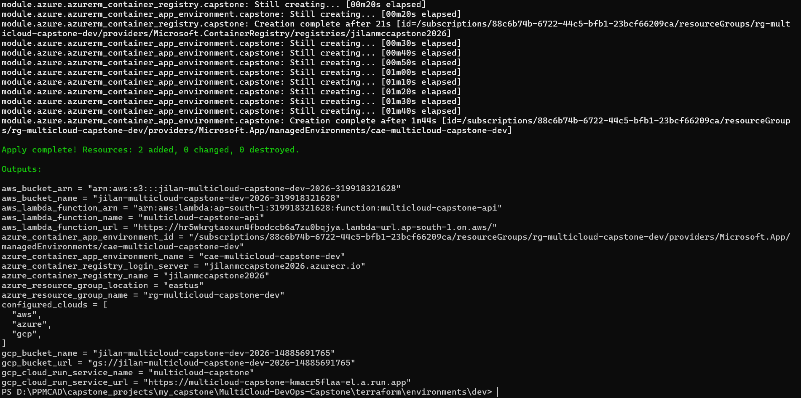
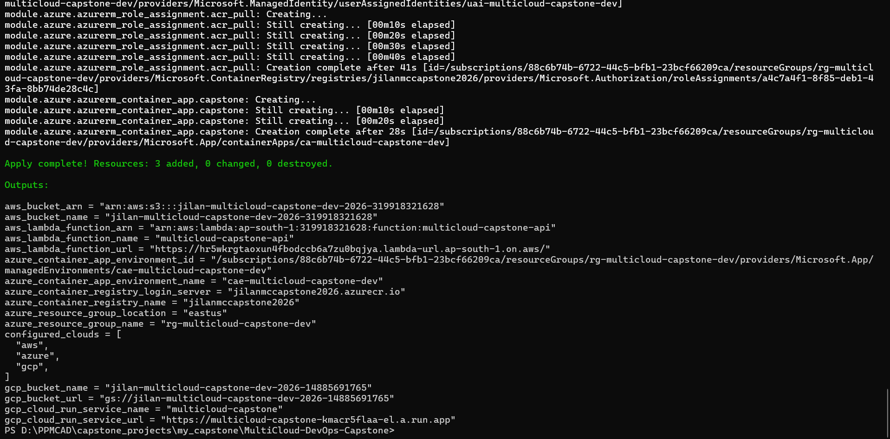
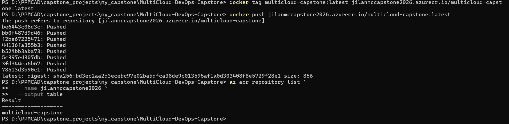
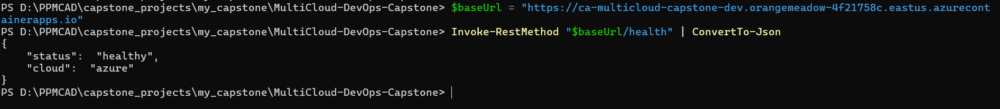
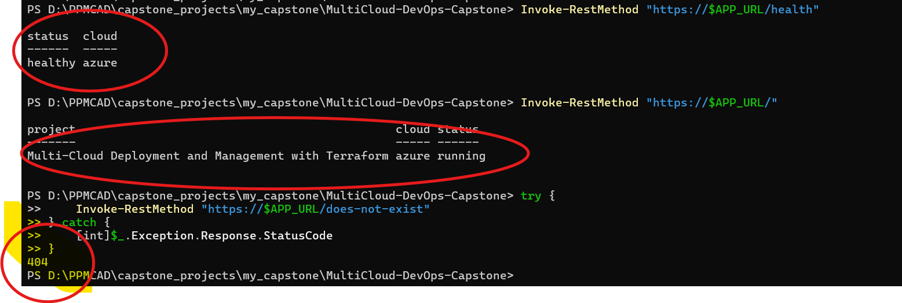
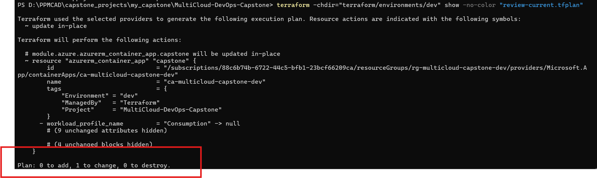
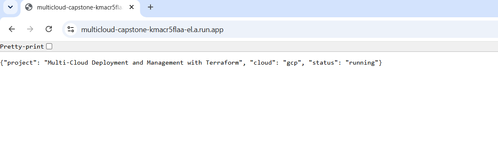
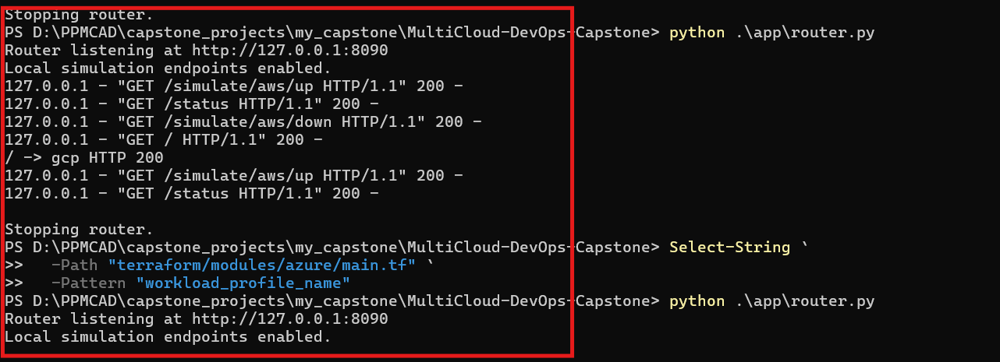
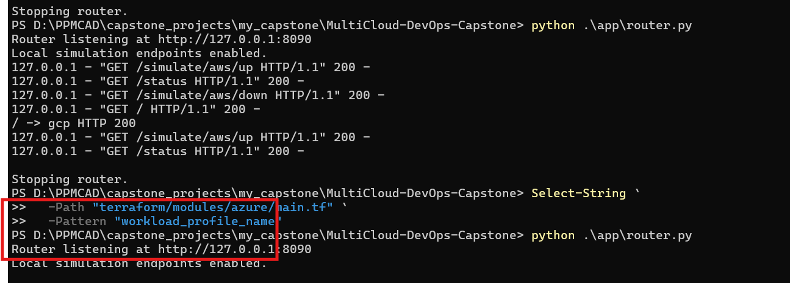
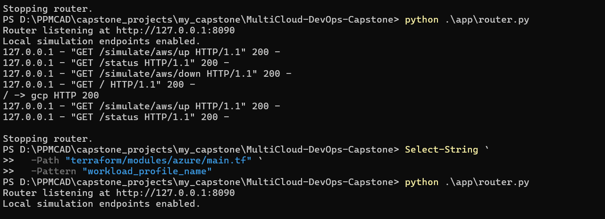

# Multi-Cloud Deployment and Management with Terraform

An individual DevOps capstone project demonstrating Infrastructure as Code (IaC) across Amazon Web Services (AWS), Microsoft Azure, and Google Cloud Platform (GCP). The project uses Terraform to manage cloud resources and demonstrates application health checks, container deployment, and simulated cross-cloud routing, failover, and recovery.

**Project focus:** Infrastructure as Code, multi-cloud deployment, security, cost control, application availability, recovery, and technical evidence.

> **Cost and safety first:** Cloud services can incur charges even when lightly used. Review every Terraform plan before applying it. This project uses existing cloud resources, including resources in an academic GCP project. Never destroy shared resources or modify project-wide permissions without explicit authorization.

## Table of contents

- [Project goals](#project-goals)
- [Architecture](#architecture)
- [Repository layout](#repository-layout)
- [Technology stack](#technology-stack)
- [Deployed resources](#deployed-resources)
- [Application endpoints](#application-endpoints)
- [Router failover demonstration](#router-failover-demonstration)
- [Prerequisites](#prerequisites)
- [Authentication](#authentication)
- [Terraform workflow](#terraform-workflow)
- [Screenshot evidence](#screenshot-evidence)
- [Security considerations](#security-considerations)
- [Cost management](#cost-management)
- [Current status and future work](#current-status-and-future-work)

## Project goals

- Manage AWS, Azure, and GCP infrastructure with Terraform.
- Organize cloud-specific resources into reusable Terraform modules.
- Deploy an HTTP application across cloud environments.
- Verify application health using HTTP endpoints.
- Demonstrate simulated routing, failover, and recovery.
- Capture deployment and testing evidence for the capstone report.
- Apply secure authentication and cost-conscious resource configurations.
- Extend the project with CI/CD, monitoring, and backup/restore testing.

## Architecture

The project combines a cloud-specific application deployment with a local Python routing simulation.

```text
                  Multi-Cloud Capstone
                           |
                Terraform IaC (dev)
                           |
          +----------------+----------------+
          |                |                |
         AWS             Azure              GCP
          |                |                |
       Lambda        Container Apps       Cloud Run
          |                |                |
     HTTP API       Docker container    Docker container
     IAM-protected   Public ingress      Public service
          |
      Health check

       Local Python Router
                |
       +--------+--------+
       |                 |
    AWS Lambda         GCP Cloud Run
       |                 |
       +-- simulated routing,
           failover and recovery
```

The local router is a demonstration component. Its simulated failover is not the same as production DNS failover or a managed global traffic-routing service.

## Repository layout

```text
.
├── .github/
│   └── workflows/
│       └── terraform-checks.yml
├── app/
│   ├── app.py
│   ├── Dockerfile
│   ├── lambda_function.py
│   └── router.py
├── docs/
│   └── screenshots/
├── terraform/
│   ├── environments/
│   │   └── dev/
│   │       ├── main.tf
│   │       ├── outputs.tf
│   │       ├── providers.tf
│   │       ├── variables.tf
│   │       └── versions.tf
│   └── modules/
│       ├── aws/
│       ├── aws_lambda/
│       ├── azure/
│       └── gcp/
├── monitoring/
├── scripts/
├── .gitignore
└── README.md
```


The layout above summarizes the main project components. Refer to the repository for the exact files currently present in each directory.

## Technology stack

| Technology | Purpose |
|---|---|
| Terraform | Infrastructure as Code |
| AWS Lambda | Serverless HTTP API |
| Amazon S3 | Object storage with public access blocked and server-side encryption |
| Azure Container Registry | Container image storage |
| Azure Container Apps | Managed container hosting with scale-to-zero configuration |
| Google Cloud Run | Managed container hosting |
| Docker | Container packaging |
| Python | HTTP application and router simulation |
| PowerShell | Local commands and deployment validation |
| Git and GitHub | Source control and project collaboration |

## Deployed resources

### AWS

- Lambda function: `multicloud-capstone-api`
- Region: `ap-south-1` (Mumbai)
- Function URL authentication: `AWS_IAM`
- S3 bucket: `jilan-multicloud-capstone-dev-2026-319918321628`
- S3 public access is blocked and server-side encryption is configured.

The Lambda health endpoint was tested successfully with an authenticated request returning HTTP 200.

Because the Lambda Function URL uses IAM authentication, a normal unauthenticated browser request is not expected to work.

### Microsoft Azure

- Resource group: `rg-multicloud-capstone-dev`
- Region: `East US`
- Azure Container Registry: `jilanmccapstone2026`
- Container Apps environment: `cae-multicloud-capstone-dev`
- Container App: `ca-multicloud-capstone-dev`
- Registry authentication: user-assigned managed identity with the `AcrPull` role
- Container ingress: public, port 8080
- CPU: 0.25
- Memory: 0.5 GiB
- Minimum replicas: 0
- Maximum replicas: 2

Container image:

```text
jilanmccapstone2026.azurecr.io/multicloud-capstone:latest
```

Application URL:

https://ca-multicloud-capstone-dev.orangemeadow-4f21758c.eastus.azurecontainerapps.io

The Azure Container App was deployed successfully, and the image was pushed to ACR. The configuration permits scale-to-zero; actual scaling behavior and associated costs depend on platform behavior and workload.

### Google Cloud Platform

- Project ID: `heroviredacademics`
- Cloud Run service: `multicloud-capstone`
- Region: `asia-south1`
- Minimum instances: 0
- Maximum instances: 2
- Public invocation is enabled for the demo service.

Application URL:

https://multicloud-capstone-kmacr5flaa-el.a.run.app

The project also uses a GCP Cloud Storage bucket managed through Terraform. Because this is an academic project, changes to shared project-level settings and IAM permissions must be handled carefully.

## Application endpoints

The containerized Python application in `app/app.py` exposes these routes:

| Path | Expected result | Purpose |
|---|---|---|
| `/` | HTTP 200 | Application and cloud status |
| `/health` | HTTP 200 | Health check |
| `/not-found` | HTTP 404 | Not-found handling example |

The application uses the `CLOUD_NAME` environment variable to identify the cloud and `PORT` to configure the HTTP listener.

Example health response:

```json
{
  "status": "healthy",
  "cloud": "azure"
}
```

Example home response:

```json
{
  "project": "Multi-Cloud Deployment and Management with Terraform",
  "cloud": "azure",
  "status": "running"
}
```

### Test the Azure deployment

Run the following commands in PowerShell:

```powershell
$baseUrl = "https://ca-multicloud-capstone-dev.orangemeadow-4f21758c.eastus.azurecontainerapps.io"

Invoke-RestMethod "$baseUrl/health" | ConvertTo-Json
Invoke-RestMethod "$baseUrl/" | ConvertTo-Json
```

To test not-found handling:

```powershell
try {
    Invoke-RestMethod "$baseUrl/not-found"
} catch {
    [int]$_.Exception.Response.StatusCode
}
```

Expected status: `404`.

These tests validate the HTTP behavior of the deployed Azure application. Use cloud-specific authentication where required when testing the AWS endpoint.

## Router failover demonstration

The Python router in `app/router.py` provides a local simulation of routing between AWS Lambda and GCP Cloud Run.

Start the router from the repository root:

```powershell
python .\app\router.py
```

The local router listens at:

```text
http://127.0.0.1:8090
```

The simulation provides endpoints for:

- `/` — route a request to the selected healthy cloud.
- `/status` — inspect the router's current status.
- `/simulate/aws/down` — simulate AWS being unavailable.
- `/simulate/aws/up` — restore AWS in the simulation.

Example demonstration sequence:

1. Start the router.
2. Open `/` and `/status` to record the initial state.
3. Call `/simulate/aws/down`.
4. Request `/` again and inspect `/status` to observe the resulting routing decision.
5. Call `/simulate/aws/up`.
6. Request `/` and `/status` again to record recovery.

The demonstration screenshots are stored in `docs/screenshots/`.

**Scope limitation:** This is a local routing simulation. It does not automatically redirect public DNS traffic, continuously monitor production endpoints, or establish production-grade disaster recovery. Actual behavior depends on the router implementation and the availability of the configured backend services.

## Prerequisites

- Windows, VS Code, and PowerShell
- Git
- Terraform CLI
- Docker Desktop
- AWS CLI
- Azure CLI
- Google Cloud CLI
- Authenticated cloud accounts with the required resource permissions

Use versions compatible with the provider constraints defined in the Terraform configuration.

## Authentication

Authenticate using your cloud CLIs or approved identity federation. Do not place credentials directly in Terraform files or application source code.

### AWS

```powershell
aws sts get-caller-identity
aws configure list
```

Use an approved AWS profile or role with only the permissions required for the project.

### Azure

```powershell
az login
az account show
```

Verify that the active subscription is the intended subscription before provisioning:

```powershell
az account list --output table
```

### Google Cloud

```powershell
gcloud auth list
gcloud config get-value project
gcloud auth application-default login
```

Verify the project ID and available permissions before running Terraform.

Never commit credentials, service-account keys, `.env` files, Terraform state files, or files containing secrets.

## Terraform workflow

Run commands from the repository root. The examples below use Terraform's `-chdir` option to avoid ambiguity about the working directory.

### Initialize

```powershell
terraform -chdir="terraform/environments/dev" init
```

### Format and validate

```powershell
terraform -chdir="terraform/environments/dev" fmt -check -recursive
terraform -chdir="terraform/environments/dev" validate
```

### Review the plan

```powershell
terraform -chdir="terraform/environments/dev" plan -out="review.tfplan"
terraform -chdir="terraform/environments/dev" show -no-color "review.tfplan"
```

Review all additions, updates, replacements, and deletions before proceeding. Pay particular attention to shared buckets, IAM resources, and existing cloud services.

Only apply a reviewed plan when the proposed actions are understood and approved:

```powershell
terraform -chdir="terraform/environments/dev" apply "review.tfplan"
```

Do not blindly apply a previously saved plan after the configuration or remote infrastructure has changed. Generate and review a fresh plan when needed.

### Inspect outputs

```powershell
terraform -chdir="terraform/environments/dev" output
```

Outputs may contain infrastructure identifiers and endpoint URLs. Review them before sharing screenshots or logs publicly.

### State safety

- Keep Terraform state private and protected.
- Do not commit `.tfstate` or `.tfstate.backup` files.
- Back up state before undertaking risky state operations.
- Do not manually edit Terraform state.
- Never run `terraform destroy` against the shared environment without reviewing its impact and receiving the necessary authorization.

## Screenshot evidence

The following screenshots document the deployed resources and application behavior. They are embedded directly from `docs/screenshots/`.

### Azure infrastructure and deployment

**Terraform infrastructure apply**



**Container App deployment**



**Container image push to ACR**



### Azure application testing

**Health check**



**Home endpoint**



**Not-found response**


### Terraform outputs



### Router simulation

**Healthy GCP routing**



**Simulated failover**



**Simulated recovery**



**Router status**



These images are project evidence, not a substitute for reviewing the underlying Terraform configuration, plan output, and test results.

## Security considerations

- Keep AWS Lambda Function URL authentication set to IAM unless public access is explicitly required.
- Keep S3 public access blocked and encryption enabled.
- Use managed identities for Azure Container Apps to pull images from ACR.
- Avoid registry administrator credentials where identity-based access is supported.
- Restrict cloud IAM permissions to the minimum required.
- Do not make changes to shared GCP project permissions without authorization.
- Do not expose access tokens, account keys, subscription credentials, or sensitive Terraform outputs in screenshots.
- Treat public application URLs as public endpoints and avoid returning secrets or sensitive data.

## Cost management

Cloud services may incur charges even when application traffic is low.

1. Review AWS, Azure, and GCP pricing and applicable academic credits.
2. The Azure Container Registry uses the Basic tier, which has a recurring charge.
3. Azure Container Apps and Cloud Run are configured for scale-to-zero, but logging, networking, registry storage, and other services may still incur charges.
4. Review AWS Lambda, S3 storage, Cloud Run, Cloud Storage, and monitoring costs.
5. Avoid adding NAT gateways, managed Kubernetes, premium load balancers, or managed databases unless required by the project.
6. Set budget alerts in each cloud environment. Budget alerts are notifications, not automatic spending caps.
7. Review Terraform plans before changes to existing resources.
8. Keep an inventory of resources that are safe to remove. Never delete shared academic resources merely to reduce costs.

## Current status and future work

### Implemented and demonstrated

- [x] Terraform-based multi-cloud configuration and reusable modules
- [x] AWS Lambda HTTP API with IAM-protected Function URL
- [x] Azure Container Registry and container image push
- [x] Azure Container Apps deployment with managed identity and scale-to-zero configuration
- [x] GCP Cloud Run deployment
- [x] Application health-check and HTTP route implementation
- [x] Local router simulation with failover and recovery endpoints
- [x] Screenshot evidence for infrastructure, application tests, and router demonstrations

### Remaining work

- [ ] Finalize and test multi-cloud CI/CD workflows
- [ ] Automate container image publishing to ECR, ACR, and Google Artifact Registry
- [ ] Automate separate ZIP packaging and deployment for AWS Lambda
- [ ] Configure monitoring and alerting appropriate to the project budget
- [ ] Document and test backup/restore procedures
- [ ] Review least-privilege IAM and CI identity federation
- [ ] Perform a final Terraform plan review and document any remaining configuration differences
- [ ] Complete the capstone report and viva preparation

Update this checklist only after the corresponding workflow or test has been completed and verified.

## Conclusion

This capstone demonstrates how Terraform can organize infrastructure across AWS, Azure, and GCP while keeping deployment configuration, security considerations, and test evidence in one repository. The application endpoints and local router simulation provide a foundation for further work on automated delivery, monitoring, and disaster-recovery testing.

