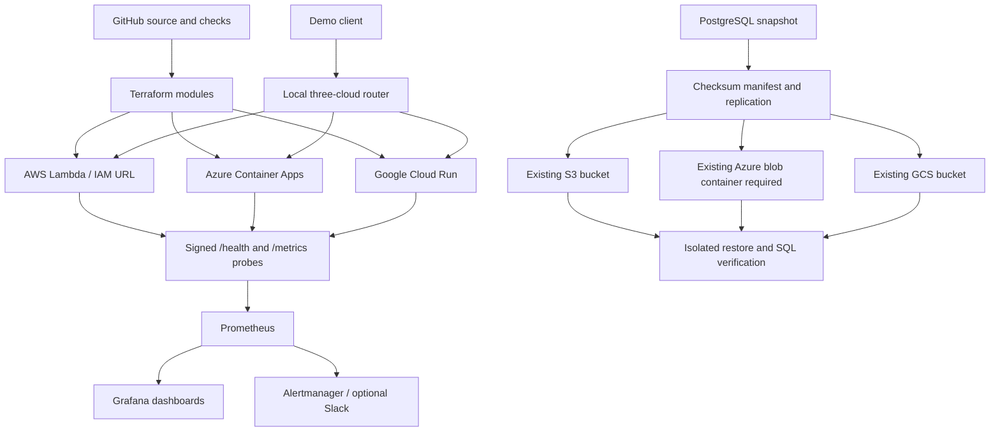

# Submission report and viva guide

**Project:** Multi-Cloud Deployment and Management with Terraform  
**Submission deadline:** 31 October 2026  
**Review date:** 26 October 2026  
**Constraint:** existing cloud resources only

## Abstract

This project manages a serverless application across AWS Lambda, Azure Container
Apps and Google Cloud Run using reusable Terraform modules. A local Python router
selects healthy backends and retries failures, while Prometheus and Grafana expose
availability, latency, sampled process resource use, backup freshness and cost
thresholds. PostgreSQL snapshot tooling replicates data into existing cloud object
stores and verifies integrity during recovery. CI workflows validate changes, publish
release artifacts and support reviewed infrastructure updates using federated identity.

The tested local implementation and the live deployment must be distinguished.
The local router is a single point of failure. Managed global routing is supplied as
an optional, disabled extension. Production DNS failover and a live cross-cloud
database recovery have not been proven by the local tests.

## Architecture

## Design decisions

- Serverless services reduce always-on compute for an academic workload. They are
  alternatives to the example VMs in the brief.
- Cloud-specific modules retain provider semantics; forcing a single resource schema
  across three providers would conceal meaningful differences.
- Managed identity pulls the Azure image; AWS IAM signs Lambda requests; local CLI
  sessions and CI federation avoid static keys in source.
- Same source release, separate ACR/GAR image digests and Lambda ZIP packaging.
- Backups are immutable snapshot IDs with manifests, and all replicas are downloaded
  and hashed before a backup is called successful.
- The daily backup design trades a possible snapshot-age data loss for lower cost.
  It does not promise zero-data-loss or synchronous database replication.
- Local monitoring and routing limit additional cloud spend, but are not highly
  available control-plane services.

## Evaluation evidence

| Weight | What to submit |
|---|---|
| Documentation: 15% | README, architecture, setup/authentication, module structure, state recovery, DR runbook, troubleshooting, references and honest limitations |
| Implementation: 75% | Passing CI/tests; three live endpoint checks; reproducible Terraform plan; routing failure/recovery; real backup/restore integrity; monitoring dashboard and delivered alert |
| Cost optimization: 10% | Actual dated spend by cloud and currency; project/account scope; scale-to-zero/max instance settings; storage retention review; avoided services and the availability tradeoff |

Do not invent a final mark or completion percentage. Tests and screenshots must
correspond to the submitted commit and distinguish historical evidence from current runs.

## Five-day completion schedule

| Date | Finish line |
|---|---|
| 26 October | Resolve code defects; run local tests/DR drill; reconcile the current state and credentials; review this requirements matrix |
| 27 October | Import/recover authoritative state; review a no-replacement plan; publish/deploy metrics to existing workloads; verify all three endpoints |
| 28 October | Execute routing outage/recovery; use authorized existing storage for real replica checks; record database recovery and RPO/RTO |
| 29 October | Capture Grafana/Prometheus and alert delivery/resolution; record actual bills and cost thresholds; run CI deployment evidence |
| 30 October | Freeze the submission commit; finish report, diagrams, screenshot captions and viva rehearsal; get stakeholder feedback |
| 31 October | Verify links and archive contents; upload early enough to fix submission problems |

## Demonstration sequence (10–12 minutes)

1. Explain the problem, three providers and cost constraint.
2. Show module layout, provider locks and successful validation.
3. Show each cloud's home and health responses.
4. Route requests, simulate one backend outage, show another selection and recovery.
5. Show the backup manifest, recovery from a replica and verified SQL data.
6. Show health, latency, memory, backup freshness and cost dashboards.
7. Show a firing/resolved alert and CI checks/review gate.
8. Explain remaining limitations and measured recovery results.

## Viva prompts and answers

**Why Terraform modules?** Reuse configuration while isolating provider-specific APIs,
inputs and outputs; review changes as a plan before execution.

**Why three clouds?** To explore provider portability and recovery choices. Multiple
providers alone do not establish availability; routing, data and operational access
must also survive a failure.

**What is the router's limitation?** It runs on one local host, uses sequential health
checks and handles GET requests. It is a capstone routing demonstration, not a
production proxy or resilient global entry point.

**Why not Route 53 CNAME directly to all endpoints?** Provider host routing and TLS
certificates must match the requested hostname, and the AWS Function URL requires
signed requests. DNS alone cannot solve those application/authentication differences.

**How do you prevent secrets in Git?** Default credential chains/federation, private
state/plan storage, ignored credential files, scoped identities and no Terraform
secret data sources for provider credentials.

**What does a checksum prove?** The recovered bytes match the protected manifest.
Database consistency additionally needs SQL and application validation.

**RPO versus RTO?** RPO bounds recoverable data age; RTO measures the full recovery
duration. A once-daily snapshot cannot guarantee zero data loss.

**Why is Vault not mandatory here?** The sprint allows Vault or a similar mechanism.
Short-lived federation and managed identity satisfy credential handling needs without
operating another service. An assessor requiring Vault specifically must approve that
substitution or provide an existing Vault service.

**Does an alert stop spending?** No. Thresholds notify. Scale limits, retention,
service selection and human response control cost.

**What is still required for production?** Resilient global ingress, tested cloud DR,
well-defined SLOs, secured private data paths where needed, complete access controls,
audited state recovery, proven rollback and operational ownership.

## Final evidence checklist

- [ ] Authoritative state restored and backed up privately.
- [ ] Current plan has no unexpected creation/replacement/deletion.
- [ ] Existing AWS/Azure/GCP workloads run the submitted release.
- [ ] Each /health and /metrics response is captured with a timestamp.
- [ ] Three-cloud routing and failure/recovery evidence saved.
- [ ] Real remote replicas and database restore verified, or limitation explicitly stated.
- [ ] Prometheus targets and Grafana panels have real data.
- [ ] Slack alert delivered and resolved, or integration explicitly marked pending.
- [ ] Actual spend, currency, billing scope and thresholds recorded.
- [ ] CI checks and a reviewed deployment run linked.
- [ ] Fresh home/404 screenshots, clear captions and no secrets.
- [ ] Reviewer/stakeholder feedback recorded and addressed.
- [ ] Report/archive links open correctly from a different browser session.

## References

- [Terraform S3 backend](https://developer.hashicorp.com/terraform/language/backend/s3)
- [Microsoft Front Door Terraform example](https://learn.microsoft.com/azure/frontdoor/create-front-door-terraform)
- [AWS API Gateway HTTP APIs](https://docs.aws.amazon.com/apigateway/latest/developerguide/http-api.html)
- [PostgreSQL pg_dump](https://www.postgresql.org/docs/16/app-pgdump.html)
- [Prometheus configuration](https://prometheus.io/docs/prometheus/latest/configuration/configuration/)
- [AWS cost API](https://docs.aws.amazon.com/aws-cost-management/latest/APIReference/API_GetCostAndUsage.html)
- [Azure cost query API](https://learn.microsoft.com/en-us/rest/api/cost-management/query/usage?view=rest-cost-management-2025-03-01)
- [GCP billing export queries](https://docs.cloud.google.com/billing/docs/how-to/bq-examples)
